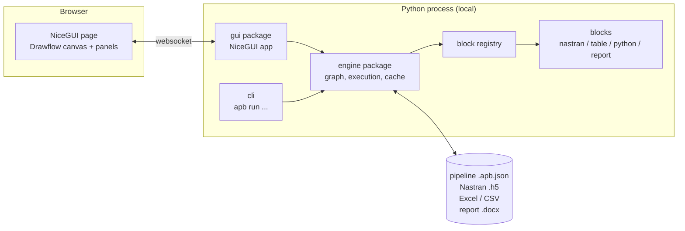

# 00 — Architecture & Overview

## 1. Purpose

Structural analysts repeatedly perform the same chain of work: run MSC Nastran, extract
results, massage them (often in Excel), do hand calculations, and write a report. When the
input changes, the whole chain is redone by hand.

The Potato Pipeline lets the analyst build this chain **once** as a graphical
pipeline (Simulink-style boxes and connectors) and **re-run it** whenever the input changes,
regenerating all intermediate results and the Word report.

**Name.** The tool is shown as **Potato Pipeline** (README, GUI, command-line help, reports). Its internal name stays `apb`: the Python package `apb`, the command `apb`, pipeline files `*.apb.json`, the config folder `apb` and the plugin entry-point group `apb.blocks`.

### 1.1 Vocabulary

| Term | Meaning |
|------|---------|
| **Block** | One step of a pipeline, drawn as a box on the canvas (not "box" or "node") |
| **Block type** | The kind of block, chosen from the block library (e.g. "Nastran HDF5 results") |
| **Port** | An input or output of a block |
| **Connector** | The line carrying data from an output port to an input port |
| **Pipeline** | Blocks and connectors, saved as one `.apb.json` file |
| **Toolbox** | A collection of block types (later: a folder that can be extended) |

## 2. Goals

| ID | Goal | Prio |
|----|------|------|
| ARC-01 | Graphical pipeline editor in the web browser (Firefox, Edge, Chrome) | M |
| ARC-02 | Pipelines are saved as human-readable text files that can be version-controlled (git) | M |
| ARC-03 | Pipelines can run **without the GUI** (command line), e.g. in batch or CI | M |
| ARC-04 | A library of standard blocks that grows over time; new blocks are plain Python classes | M |
| ARC-05 | Users can write custom Python inside a block | M |
| ARC-06 | Output is a Word (`.docx`) report | M |
| ARC-07 | Only re-compute blocks whose inputs or settings changed | S |
| ARC-08 | Third-party block packages (e.g. a future fastener-calculation package) can be installed and appear in the library automatically | S |
| ARC-09 | Runs locally on the analyst's workstation; no server infrastructure required | M |
| ARC-10 | Runs on **Windows** (deployment target) and **Linux** (development); both are tested in CI | M |
| ARC-11 | Unit systems `SI` (m) and `SI_mm` (mm); units are tracked on every table, conversion is explicit, reports always state units (§5.1) | M |

Non-goals for v1: multi-user collaboration, authentication, remote execution, running Nastran
from the tool (the tool starts from existing `.h5` result files).

## 3. Technology stack

All dependencies are mature, widely used, and actively maintained.

| Concern | Choice | Rationale |
|---------|--------|-----------|
| Language | Python ≥ 3.12 | Project requirement |
| Packaging / env | `pyproject.toml`, **uv** (pip-compatible) | Modern standard; fast, reproducible lock file |
| Data model / validation | **Pydantic v2** | Industry standard; block parameters are Pydantic models → validation, JSON (de)serialisation and auto-generated GUI forms for free |
| Tabular data | **pandas** | De facto standard; analysts already know it; reads/writes Excel & CSV |
| Numerics | **NumPy** | Standard |
| Nastran results | **h5py** | Standard HDF5 reader; small dependency footprint. *No pyNastran.* |
| Excel I/O | **openpyxl** (via pandas) | Standard `.xlsx` engine |
| Plots / figures | **matplotlib** | Standard; renders PNG for the Word report |
| Word output | **python-docx**; **docxtpl** (Jinja2 in Word) for user templates | Standard libraries for `.docx` |
| GUI | **NiceGUI** (on FastAPI + Vue, served to the browser) | Write the GUI in Python; one embedded JS node-editor component |
| Node canvas (JS) | **Drawflow** (MIT, vanilla JS, no build step), vendored | Simple, no npm toolchain. Isolated behind one wrapper so it can be swapped (e.g. React Flow / Vue Flow) later |
| CLI | **Typer** | Standard, type-hint based |
| Tests / quality | **pytest**, **ruff** (lint + format), **mypy** (strict) | Standard |

Coding rules: every public module, class and function has a docstring (Google style) and full
type hints; `mypy --strict` and `ruff` pass in CI.

### 3.1 Cross-platform rules (Linux development, Windows deployment)

- All paths handled with `pathlib`; never build paths with string concatenation or `/`.
- Pipeline files store paths with forward slashes and relative to the pipeline file where
  possible, so a pipeline created on Linux opens on Windows and vice versa.
- Files are opened with explicit `encoding="utf-8"`; line endings are not significant.
- No dependency requires a compiler on Windows (all have binary wheels for Windows & Linux).
- Windows locks files open in Word/Excel: writing a report or workbook that is open gives a
  clear error ("close `report.docx` in Word and re-run") instead of a traceback.
- CI runs the test suite on `ubuntu-latest` and `windows-latest`.
- Installation on Windows: `uv tool install` / `pip install` of the package; later a
  self-contained installer may be added (out of scope for v1).

## 4. Component overview



**Key rule:** the `engine` package has **no dependency on the GUI**. The GUI is only an editor
and runner for pipeline files. Everything the GUI can run, the CLI can run.

## 5. Data types flowing on connectors

Connectors carry typed values. v1 port types:

| Port type | Python type | Typical use |
|-----------|-------------|-------------|
| `Table` | `pandas.DataFrame` | Nastran results, load tables, margins of safety |
| `Scalar` | `float \| int`, or `Quantity(value, unit)` when it has a unit | Max stress, allowable, factor of safety |
| `Text` | `str` | Paragraphs / conclusions for the report |
| `Figure` | `matplotlib.figure.Figure` | Plots for the report |
| `Any` | `object` | Escape hatch, mainly for the Python block |

A connection is allowed only between compatible types (`Any` is compatible with everything).

### 5.1 Units (ARC-11)

Only **SI** and its common **engineering (mm) equivalent** are supported. Both are
consistent unit systems, so Nastran results are valid in either:

| Quantity | `SI` (m) | `SI_mm` (mm) | Factor SI → SI_mm |
|----------|----------|--------------|-------------------|
| Length, displacement | m | mm | 10³ |
| Force | N | N | 1 |
| Moment | N·m | N·mm | 10³ |
| Force per length (shell forces) | N/m | N/mm | 10⁻³ |
| Stress, pressure | Pa | MPa | 10⁻⁶ |
| Mass | kg | t (tonne) | 10⁻³ |
| Density | kg/m³ | t/mm³ | 10⁻¹² |
| Rotation, strain | rad, – | rad, – | 1 |
| Frequency | Hz | Hz | 1 |

Rules:
- A Nastran file does not store its units, so every input block has a **`unit_system`**
  parameter (default taken from the pipeline setting `default_unit_system`).
- Every table carries `DataFrame.attrs["unit_system"]` and `attrs["units"]` (column → unit
  string, e.g. `"MPa"`). The Nastran reader fills these from the quantity kind of each column
  (mapping table, spec 02 §3.2). Columns of unknown kind (e.g. from Excel) are unitless unless
  the user sets them.
- A **`units.convert`** block converts a table or scalar between `SI` and `SI_mm`
  (spec 03). Conversion is never implicit.
- Blocks that combine tables (`join`, `concat`, Python block inputs) **refuse to mix unit
  systems** with a clear error ("table A is SI, table B is SI_mm — add a Convert units block").
- **Reporting:** table column headers show the unit (`VON_MISES [MPa]`), scalars are printed
  with their unit, and the report states the unit system used (spec 05).
- Unit handling is a small internal module (a fixed factor table, as above); no general
  unit library is needed for two systems.

## 6. Proposed repository layout

```
pyproject.toml
src/apb/
    __init__.py
    engine/        # graph model, execution, cache, file format (no GUI imports)
    blocks/        # standard block library
        nastran/   # HDF5 reader + Nastran input blocks
        table/     # table manipulation + Excel/CSV I/O
        python/    # custom Python block
        report/    # Word report block
    gui/           # NiceGUI application + Drawflow wrapper (static/drawflow/...)
    cli.py         # `apb` command line
tests/
docs/spec/
examples/          # example pipelines + small test .h5 files
```

## 7. Version 1 — definition of done

An analyst can, in the browser:

1. Add a **Nastran HDF5 input** block, point it at an `.h5` file and pick CBUSH element forces.
2. Connect it to a **Fastener loads** block → tension and shear per fastener and load case.
3. Connect that to a **Load case table** block → one row per fastener, one column per load
   case, plus the envelope (max tension, max shear, governing load case).
4. Connect a **Python** block computing e.g. margins against a fastener allowable.
5. Connect the tables, scalars and a figure into a **Word report** block and press **Run** →
   a `.docx` report is written (also exported to Excel if wanted).
6. Save the pipeline, replace the `.h5` file, and re-run (GUI or `apb run pipeline.apb.json`)
   → the report is regenerated with new numbers.

A second example pipeline does the same for CQUAD4 stresses (max von Mises envelope).

## 8. Decisions taken (review round 1)

- **Nastran version:** kept open; the HDF5 reader is written to be version-tolerant (spec 02 §3.2)
  and verified against real files when they are supplied.
- **Platforms:** develop on Linux, deploy on Windows → both supported (ARC-10).
- **Report template:** no company template yet; a test base document is shipped with the tool
  (spec 05 §3.2).
- **Main Excel use case today:** collecting results across load cases, e.g. fastener load
  tables (tension / shear) → dedicated blocks in spec 03.
- **Element types:** CQUAD4, CBEAM, CBUSH, RBE2, point masses (CONM2) (spec 02).

## 9. Decisions taken (review round 2)

- **Units:** SI or the engineering mm-equivalent only; m ↔ mm conversion needed; reports must
  state units clearly → §5.1.
- **Macro blocks:** not needed early, but a foreseen feature → *later* (spec 01).
- **Nastran version:** MSC Nastran **2023.3** is the reference version (spec 02).
- **Coordinate transformations:** not in v1; may become a dedicated block later.
- **RBE2:** forces are taken from RBE2 elements (also used for fastener load output) (spec 02).
- **Load case table:** tension and shear side by side in one sheet (spec 03).
- **Python block:** external `.py` files preferred (spec 04).
- **Report:** test template for development; report contains only what the user places (spec 05).

- **GUI technology:** desktop Qt was considered; decision is to stay with the **browser** GUI
  (NiceGUI + Drawflow, spec 06).

## 10. Open questions

None.
